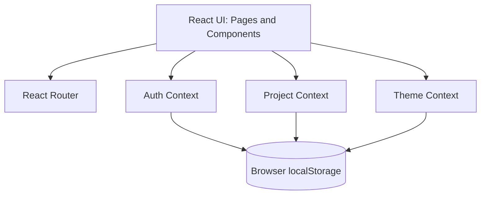

<div align="center">


  


  <h1>PROJECT GRAVEYARD</h1>


  <p>  Save what you’ve built, remember why you paused, and decide what comes next:
  revive the idea, reuse what still works, or let it rest. </p>


</div>


## Overview
**The Project Graveyard** is a frontend-only web application that helps builders document, revisit, and make decisions about unfinished projects.


Most people have projects that were paused after a hackathon, exams, work, burnout, scope creep, or lost interest. Over time, these projects disappear into old folders and repositories. The original idea, completed work, remaining tasks, and reason for stopping are often forgotten.


The Project Graveyard solves this by turning every unfinished project into a structured **Grave**. Each Grave preserves the project’s original intent, progress, unfinished work, abandonment reason, timeline, and reusable assets.


Instead of simply listing dead projects, the app helps users choose a clear next step:


- **Revive** — continue the project from where it stopped  
- **Reborn** — restart it with a clearer or smaller scope  
- **Pivot** — change the idea or direction  
- **Salvage** — reuse code, UI, research, or other assets  
- **Lay to Rest** — archive the project peacefully  


The application is designed for students, developers, designers, hackathon participants, and indie builders who have unfinished side projects scattered across folders, repositories, and notes.


The MVP is built entirely on the frontend. User sessions, projects, timelines, preferences, and reports are stored locally in the browser using `localStorage`. This makes the project fully functional as a frontend prototype.


The goal is not to replace project-management tools. The goal is to give unfinished ideas a place to exist, preserve their context, and help users decide whether they deserve a second life.


## Features
### Core Features


- **Simulated Authentication**  
  Users can sign up, sign in, and sign out. Each user can access only their own projects. Authentication is frontend-only and uses browser storage for the prototype.


- **Project Creation — New Burial**  
  Users can document an unfinished project, including its original idea, completed work, unfinished work, reason for pausing, links, and salvage tags.


- **Project Archive — Crypt**  
  Users can browse all saved projects, search by name, idea, or salvage tag, and filter projects by status, revival path, category, or tag.


- **Project Detail — Grave View**  
  Each project has a detailed view showing its original idea, completed work, unfinished work, reason it paused, links, salvage tags, timeline, and current status.


- **Project Timeline**  
  Every project maintains a chronological history of events such as creation, progress updates, pauses, revivals, pivots, archiving, and restoration.


- **Progress Logging — Revive**  
  Users can return to a project, log progress, define the next smallest step, and continue working without turning the app into a full task manager.


- **Revival Paths**  
  Users can choose what happens to an unfinished project:  
  - Revive  
  - Reborn  
  - Pivot  
  - Salvage  
  - Lay to Rest  


- **Project Health Score**  
  The app calculates an advisory score based on completed work, unfinished work, recent activity, selected revival path, and reusable assets.


- **Autopsy — Reports and Analysis**  
  Users can view graveyard insights such as total projects, resting projects, revived projects, archived projects, common abandonment reasons, common salvage tags, and projects with high revival potential.


- **Salvage Tags**  
  Users can mark reusable parts of a project, such as UI, API, research, design, dataset, or prompt templates.


- **Time Capsule**  
  Users can mark a project to revisit after 7, 30, or 90 days. Due projects are surfaced when the user returns to the app.


- **Archive and Restore**  
  Users can archive projects they no longer want to pursue and restore them later if they change their mind.


- **Search and Filters**  
  Users can quickly find old projects using search and combined filters.


- **Data Export**  
  Users can export their projects, timelines, revival paths, salvage tags, and analysis data as a downloadable JSON file.


- **Data Import**  
  Users can import a previously exported JSON file to restore or migrate their graveyard data.


- **Local Persistence**  
  Projects, timelines, user sessions, theme preferences, and settings persist after a page refresh using browser storage.


- **Ghost Intro and Guided Tour**  
  New users are welcomed by a short, skippable mascot-led introduction that explains the purpose of the app.


- **Theme Preference**  
  Users can switch between a more atmospheric dark theme and a lighter, less spooky theme. The preference is saved locally.


## Demo


<div align="center">


  


  <br/>


  


  <br/>


  <br/>

  

  
  <br/>


  
  


</div>


## Tech Stack
<div align = "center">

</div>


## Architecture


The application is a frontend prototype. React pages and components use shared context for application state, while React Router handles navigation. Project and preference data are stored in the browser.



Authentication in this prototype is simulated in the frontend; it is not a production identity or security system.

## Installation


### Prerequisites


Make sure you have the following installed:


- Node.js version 18 or later
- npm, pnpm, or yarn
- Git


### Clone the Repository


```bash
git clone [https://github.comSiddhantNK/Access-Granted---Code-Variant-.git](https://github.com/SiddhantNK/Access-Granted---Code-Variant-.git)
cd project-graveyard
```


### Install Dependencies


Using npm:


```bash
npm install
```


Using pnpm:


```bash
pnpm install
```


Using yarn:


```bash
yarn install
```


### Run Locally


Using npm:


```bash
npm run dev
```


Using pnpm:


```bash
pnpm dev
```


Using yarn:


```bash
yarn dev
```


The app will usually be available at:


```text
http://localhost:5173
```


### Build for Production


```bash
npm run build
```


To preview the production build locally:


```bash
npm run preview
```


## Usage

1. Start the app locally using the installation instructions above.
2. Create an account or sign in to enter the app.
3. Choose **New Burial** to record an unfinished project and preserve its context.
4. Use the Dashboard to browse projects in Canvas Protocol or Grid View.
5. Open a project dossier to review its details and timeline.
6. Use search and filters in the Crypt to find saved projects.
7. Choose a project action—such as reviving, archiving, restoring, or exporting—when appropriate.
8. Switch between light and dark themes using the theme control.

Authentication and data storage are frontend-only in this prototype. Use the export feature to keep a JSON copy of your data.


## Project Structure

├── Assests/
│   ├── Prjct_logo.png
│   └── technical_approach.png
├── src/
│   ├── components/
│   │   ├── GhostMascot.jsx
│   │   ├── IntroWalkthrough.jsx
│   │   └── Navbar.jsx
│   ├── context/
│   │   ├── AuthContext.jsx
│   │   ├── IntroContext.jsx
│   │   ├── ProjectContext.jsx
│   │   └── ThemeContext.jsx
│   ├── pages/
│   │   ├── Crypt.jsx
│   │   ├── Dashboard.jsx
│   │   └── LandingPage.jsx
│   ├── AppUpdated.jsx
│   ├── index.css
│   ├── main.jsx
│   └── tailwind.config.js
├── .env.example
├── .eslintrc.cjs
├── .gitignore
├── index.html
├── LICENSE
├── package.json
├── postcss.config.js
├── readme.md
└── vite.config.js


## Screenshots


<div align="center">


  


  <br/>


  


  <br/>


  


</div>


## Results

The Project Graveyard provides a frontend prototype for documenting unfinished projects, preserving project context, and exploring possible next steps. Project data and preferences are stored locally in the browser.


## Future Improvements
- Add automated tests for key project workflows.
- Improve accessibility and keyboard support for Canvas Protocol interactions.
- Continue refining mobile layouts and touch interactions.
- Strengthen validation and error feedback for data import.
- Explore additional export formats.
- Consider secure backend authentication and synced storage if the project moves beyond a frontend prototype.


## Contributing


Contributions are welcome.


### How to Contribute


1. Fork the repository.
2. Create a new branch:


```bash
git checkout -b feature/your-feature-name
```


3. Make your changes.
4. Test the app locally.
5. Commit your changes:


```bash
git commit -m "Add: short description of your change"
```


6. Push to your branch:


```bash
git push origin feature/your-feature-name
```
### Contribution Guidelines


- Keep changes focused on one feature or fix.
- Follow the existing project structure and naming conventions.
- Use clear, descriptive commit messages.
- Do not add backend dependencies unless discussed first.
- Ensure the app works after a page refresh.
- Test both desktop and mobile layouts.
- Avoid adding features that turn the app into a generic project-management tool.
- Preserve the core focus: unfinished projects, their context, and revival decisions.


### Areas for Contribution


- Improved project analysis
- Better revival-path recommendations
- Additional export formats
- Accessibility improvements
- Performance optimization
- Better empty states and error handling
- Additional timeline event types
- Improved data import validation


## License


This project is licensed under the MIT License - see the [LICENSE](LICENSE) file for details.   


<div align="center">


<sub>Built with ❤️ by Sid </sub>


</div>